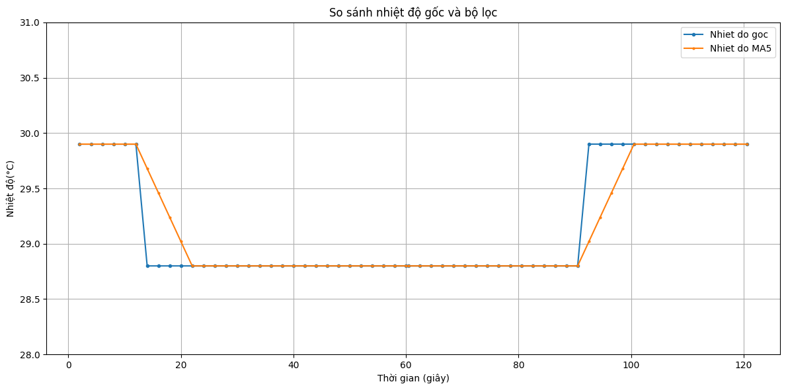
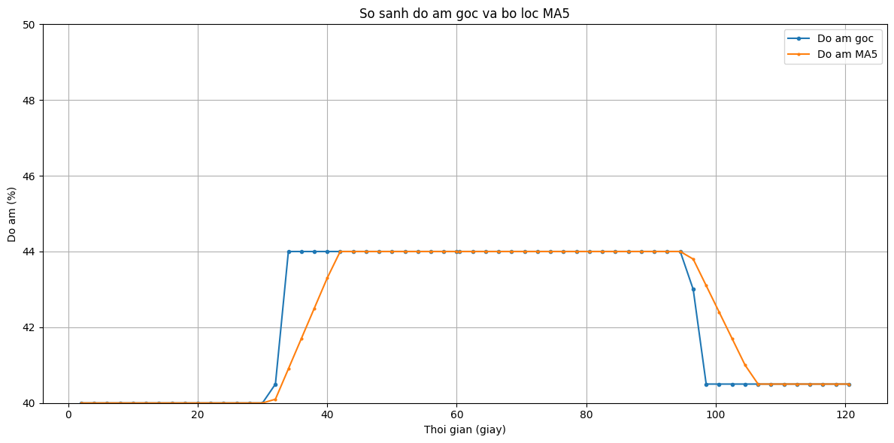

# Bài 2 — Đọc và kiểm tra cảm biến

**Họ tên:** Nguyễn Trung Hà  
**MSSV:** 23110323  
**Môn học:** CSE3069

## 1. Giới thiệu

Chương trình sử dụng cảm biến DHT22 để đo nhiệt độ và độ ẩm. Dữ liệu được kiểm tra tính hợp lệ trước khi đưa vào bộ lọc trung bình trượt 5 mẫu. Ngoài ra, chương trình có hai chế độ lập lịch lấy mẫu `delay()` và `millis()` để so sánh cách xử lý thời gian và sự kiện nút nhấn.

Bài được thực hiện trên ESP32 trong môi trường mô phỏng Wokwi.

## 2. File trong dự án

- `sketch.ino` — chương trình ESP32 đọc cảm biến DHT22, đọc ADC, xử lý nút nhấn, hiển thị OLED, lọc dữ liệu và xuất log CSV.
- `data.csv` — dữ liệu thu thập gồm thời gian, số thứ tự mẫu, nhiệt độ, độ ẩm, cờ hợp lệ, nguyên nhân lỗi, giá trị ADC, kết quả MA5, khoảng lấy mẫu thực tế và chế độ hoạt động.
- `libraries.txt` — danh sách thư viện cần sử dụng cho chương trình.
- `nhietdo.png` — ảnh kết quả liên quan đến nhiệt độ.
- `doam.png` — ảnh kết quả liên quan đến độ ẩm.

## 3. Cấu hình phần cứng

Chương trình sử dụng ESP32 DevKit với các kết nối sau:

| Thiết bị | Chân ESP32 | Chức năng |
|---|---|---|
| DHT22 | GPIO4 | Đọc nhiệt độ và độ ẩm |
| OLED SDA | GPIO21 | Đường dữ liệu I²C |
| OLED SCL | GPIO22 | Đường xung nhịp I²C |
| Biến trở | GPIO34 | Đọc giá trị ADC |
| Nút nhấn | GPIO16 | Chuyển đổi chế độ hoạt động |

Màn hình OLED sử dụng giao tiếp I²C với địa chỉ `0x3C`, độ phân giải 128 × 64 pixel. Nút nhấn được cấu hình với `INPUT_PULLUP`, nối giữa GPIO16 và GND.

Serial Monitor được cấu hình ở tốc độ 115200 baud. Chu kỳ lấy mẫu mục tiêu là 2000 ms và thời gian chống dội nút nhấn là 40 ms.

## 4. Cách chương trình hoạt động

### 4.1. Khởi tạo (`setup`)

Khi khởi động, chương trình thực hiện các công việc:

- Khởi tạo Serial ở tốc độ 115200 baud.
- Cấu hình nút nhấn GPIO16 với `INPUT_PULLUP`.
- Thiết lập độ phân giải ADC 12 bit.
- Khởi tạo giao tiếp I²C cho màn hình OLED.
- Khởi tạo cảm biến DHT22.
- Khởi tạo OLED tại địa chỉ `0x3C`.
- Quét địa chỉ I²C để kiểm tra thiết bị được kết nối.
- In tiêu đề và tên các cột dữ liệu CSV ra Serial Monitor.

Nếu không tìm thấy OLED, chương trình in cảnh báo thay vì mặc định rằng màn hình đã hoạt động bình thường.

### 4.2. Đọc và kiểm tra dữ liệu

Mỗi lần lấy mẫu, chương trình đọc nhiệt độ, độ ẩm và giá trị ADC từ biến trở.

Dữ liệu nhiệt độ và độ ẩm được kiểm tra bằng `isnan()` và giới hạn giá trị hợp lệ:

- Nhiệt độ: từ -40°C đến 80°C.
- Độ ẩm: từ 0% đến 100%.

Cột `valid` nhận giá trị `1` nếu cả nhiệt độ và độ ẩm hợp lệ; ngược lại nhận giá trị `0`.

Cột `error_reason` ghi nguyên nhân lỗi, chẳng hạn:

- `DHT_READ_FAILED`: cả hai phép đọc đều thất bại.
- `TEMP_READ_FAILED`: không đọc được nhiệt độ.
- `HUMIDITY_READ_FAILED`: không đọc được độ ẩm.
- `TEMP_OUT_OF_RANGE`: nhiệt độ nằm ngoài giới hạn.
- `HUMIDITY_OUT_OF_RANGE`: độ ẩm nằm ngoài giới hạn.

Mẫu không hợp lệ không được thêm vào bộ lọc MA5. Chương trình không thay dữ liệu lỗi bằng số 0.

### 4.3. Bộ lọc trung bình trượt MA5

Chương trình sử dụng bộ lọc trung bình trượt Moving Average với cửa sổ tối đa 5 mẫu hợp lệ gần nhất. Bộ lọc được áp dụng riêng cho nhiệt độ và độ ẩm.

**Cách tính:**

Giá trị trung bình = Tổng các giá trị mẫu hợp lệ / Số lượng mẫu hợp lệ.

Trong đó:
- Tổng các giá trị mẫu hợp lệ là tổng nhiệt độ hoặc độ ẩm của các mẫu được đưa vào bộ lọc.
- Số lượng mẫu hợp lệ là số mẫu đang được sử dụng để tính trung bình, tối đa là 5 mẫu.
- Khi chưa đủ 5 mẫu, chương trình tính trung bình trên số mẫu hợp lệ hiện có.
- Các mẫu không hợp lệ không được đưa vào bộ lọc.

Bộ lọc MA5 giúp làm giảm dao động ngắn hạn của dữ liệu, từ đó giúp giá trị nhiệt độ và độ ẩm hiển thị ổn định hơn.

### 4.4. Hai chế độ lập lịch lấy mẫu

Chương trình hỗ trợ hai chế độ hoạt động, được chuyển đổi bằng nút nhấn GPIO16.

**Chế độ A — `delay()`**

Chương trình đọc cảm biến rồi sử dụng `delay(2000)` để chờ trước lần lấy mẫu tiếp theo. Trong thời gian chờ, vòng lặp chính bị tạm dừng nên việc xử lý các sự kiện khác có thể bị chậm.

**Chế độ B — `millis()`**

Chương trình sử dụng thời gian hệ thống `millis()` để xác định khi nào đến chu kỳ lấy mẫu tiếp theo. Trong thời gian chờ, vòng lặp vẫn tiếp tục xử lý nút nhấn và các công việc khác.

Hai chế độ được đưa vào để quan sát khoảng lấy mẫu thực tế và khả năng phản hồi khi nhấn nút. Kết quả cần được đánh giá dựa trên các giá trị được ghi trong `data.csv`, không chỉ dựa trên chu kỳ mục tiêu 2000 ms.

## 5. Thu thập và lưu dữ liệu

Dữ liệu được xuất qua Serial Monitor theo định dạng CSV. Các cột gồm:

| Cột | Ý nghĩa |
|---|---|
| `time_ms` | Thời gian tính từ lúc chương trình bắt đầu |
| `sample` | Số thứ tự mẫu |
| `temp_c` | Nhiệt độ đo được, đơn vị °C |
| `humidity_pct` | Độ ẩm đo được, đơn vị % |
| `valid` | Cờ xác định mẫu hợp lệ |
| `error_reason` | Nguyên nhân lỗi nếu có |
| `adc` | Giá trị ADC đọc từ biến trở |
| `avg5_temp_c` | Nhiệt độ sau lọc MA5 |
| `avg5_humidity_pct` | Độ ẩm sau lọc MA5 |
| `interval_actual_ms` | Khoảng thời gian thực tế giữa các lần lấy mẫu |
| `mode` | Chế độ `delay` hoặc `millis` |

## 6. Kết quả và hình ảnh

Thời gian lấy mẫu mục tiêu là 2000 ms. Kết quả được tổng hợp từ log thực nghiệm của hai chế độ `delay()` và `millis()`.

| Chế độ | Số mẫu hợp lệ | Khoảng lấy mẫu quan sát được | Độ lệch so với mục tiêu |
|---|---:|---:|---:|
| A — `delay()` | 31 | Khoảng 2051 ms | Khoảng +51 ms |
| B — `millis()` | 30 | 2000 ms | 0 ms |

Ở bản A, khoảng đo thực tế gồm thời gian đọc cảm biến cộng với 2000 ms chờ, nên log cho thấy chu kỳ khoảng 2051 ms. Trong thời gian delay(), ngắt vẫn ghi nhận sự kiện nhấn nút, nhưng vòng lặp chỉ xử lý và in sự kiện sau khi kết thúc thời gian chờ; độ trễ phụ thuộc thời điểm bấm.

Ở chế độ B, chương trình sử dụng millis() để kiểm tra thời điểm lấy mẫu tiếp theo mà không cần chặn toàn bộ vòng lặp bằng thời gian chờ. Log ghi nhận các mẫu cách nhau đúng 2000 ms

### 6.1. Kết quả nhiệt độ

Ảnh `nhietdo.png` được sử dụng để minh họa kết quả liên quan đến nhiệt độ. Khi phân tích dữ liệu, có thể đối chiếu giá trị nhiệt độ thô với cột `avg5_temp_c` để quan sát tác động của bộ lọc MA5.

### 6.2. Kết quả độ ẩm

Ảnh `doam.png` được sử dụng để minh họa kết quả liên quan đến độ ẩm. Cột `humidity_pct` thể hiện số đo thô, trong khi `avg5_humidity_pct` thể hiện giá trị sau lọc.

